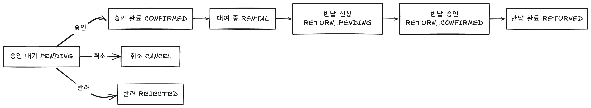
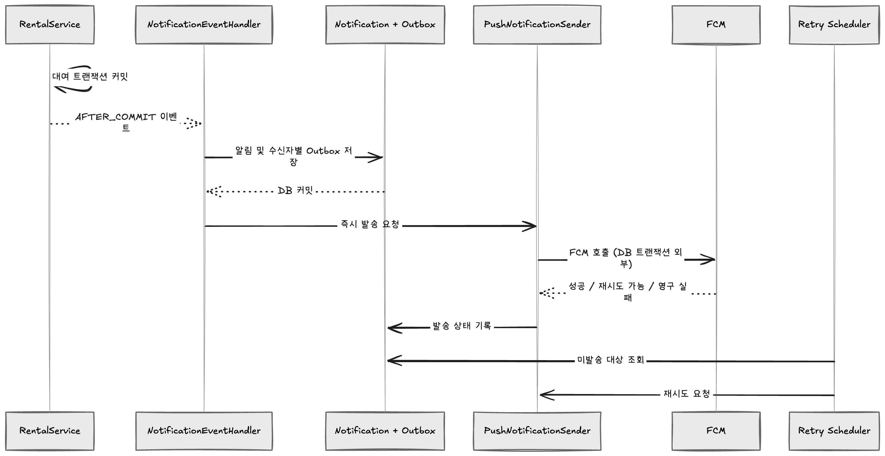

# 빌릴게 (Billilge) — 국민대학교 소프트웨어융합대학 복지물품 대여 서비스

> 학생회실 방문·엑셀 대조에 의존하던 복지물품 대여를 **온라인 신청, 납부자 검증, 재고·대여 상태 관리, 관리자 알림**으로 연결한 서비스입니다.
>
> **이 저장소는 빌릴게 백엔드**를 다룹니다. 개발 후 실제 학생회 운영 과정에서 발생한 정책·안정성·성능 문제를 지속적으로 개선하고 있습니다.

## 1. 프로젝트 소개

국민대학교 소프트웨어융합대학 학생회는 우산, 충전기 등 학생들이 잠시 필요로 하는 물품을 대여합니다. 하지만 기존 운영 방식에서는 학생이 물품 현황을 확인하거나 신청하려면 학생회실을 방문해야 했고, 운영진은 학생회비 납부 여부와 재고·대여 기록을 엑셀 및 수작업으로 관리해야 했습니다.

빌릴게는 이러한 과정을 시스템으로 옮겨 **학생은 방문 전에 대여를 신청하고, 운영진은 승인·대여·반납 업무에 집중**할 수 있도록 만들었습니다. 단순 신청 폼에서 끝내지 않고, 학생회 정책과 실제 운영 흐름을 서버의 비즈니스 규칙으로 구현했습니다.

### 해결하고자 한 문제


| 기존 문제                        | 빌릴게의 해결 방향              |
| ---------------------------- | ----------------------- |
| 방문해야만 확인할 수 있는 물품·재고         | 물품 목록 및 재고 현황 온라인 제공    |
| 운영진이 엑셀에서 직접 확인하던 회비 납부 여부   | 가입·납부자 명단 연동을 통한 자격 확인  |
| 신청·승인·수령·반납 상태를 사람마다 다르게 기록  | 대여 상태와 처리 이력의 일원화       |
| 근무자가 현장에 상주하거나 반복 안내해야 하는 부담 | 사전 신청, 관리자 대시보드 및 알림 제공 |
| 학기별 정책 변경에 따른 반복적인 코드 수정     | 시험 기간 등 운영 설정의 데이터화     |


### 운영 성과


| 지표                | 결과                                                      |
| ----------------- | ------------------------------------------------------- |
| 연간 대여 이용          | **101건 → 178건** (**약 76% 증가**, 도입 첫해 전후 비교)             |
| 누적 대여 이용          | **627건** (서비스 운영 집계 기준)                                 |
| 관리자 알림 모델         | 동일 공지를 관리자 수만큼 저장하던 방식에서 **공지 1건 저장**으로 변경              |
| 납부자 목록 조회 API p95 | 약 47% 감소 (스테이징 환경에서 SQL 콘솔 로깅 제거 전후) |


> 이용 건수는 학생회 운영 집계에 기반한 지표입니다. API 지연 수치는 **가상 사용자 100명 · 5분 · 납부자 약 2,000건** 조건에서 측정한 특정 API(`GET /admin/members/payers`) 결과로, 서비스 전체 응답 속도를 의미하지 않습니다. 비동기 로깅 도입의 추가 개선량은 별도 측정이 필요합니다. [관련 PR #152](https://github.com/billilge/backend/pull/152)

## 2. 주요 기능

### 학생

- Google OAuth2 로그인 및 JWT 기반 인증
- 복지물품 목록·재고 조회, 대여 신청 및 신청 취소
- 대여 진행 상태 및 이력 조회, 반납 신청
- 신청·승인·반려·반납 관련 인앱 알림 및 FCM 푸시

### 운영진

- 신청 승인·반려, 대여·반납 상태 관리 및 처리자 기록
- 물품 등록·수정·재고 관리, 관리자 대시보드
- 학생회비 납부자 명단 관리와 엑셀 다운로드
- 관리자 권한 구분(`ADMIN`, `WORKER`, `GA`) 및 관리 기능 접근 통제
- 시험 기간 등 운영 정책 설정, 디스플레이 일정·포스터 관리

## 3. 서비스 정책과 도메인 설계

### 3.1 학생회비 납부자 검증: 불완전한 원천 데이터와 오인증 위험

**문제** — 운영 명단은 학번의 일부가 마스킹되거나 누락될 수 있고, 이름만으로 검증하면 동명이인에게 잘못 대여 자격을 부여할 수 있습니다. 회원가입 흐름에 엑셀의 불완전한 데이터 모델을 그대로 옮길 수 없었습니다.

**설계** — 납부자(`Payer`)와 서비스 회원(`Member`)을 분리하고, 회원가입 시 이름·입학연도로 납부자 후보를 조회한 다음 후보 수와 학번 일치 여부를 검토합니다. 이름 하나만으로 납부자를 확정하지 않으며, 납부자 명단의 등록·삭제에 따라 회원의 `isFeePaid`도 갱신합니다. 이름과 입학연도 조회, 전체 학번 비교, 마스킹 값(`XXXX`) 처리 분기를 별도로 둔 것이 특징입니다.

**의사결정** — 인증 정보와 회비 납부 기록은 출처·갱신 주기가 다르므로 하나의 회원 엔티티로 합치지 않았습니다. 다만 현재 코드는 모든 부분 누락 사례를 일반화해 해결하는 정교한 신원확인 시스템이 아니며, 명단 형식과 매칭 예외 케이스에 대한 추가 검증이 필요합니다.

- 구현: [`PayerService.isPayer()`](https://github.com/billilge/backend/blob/develop/src/main/kotlin/site/billilge/api/backend/domain/payer/service/PayerService.kt)

### 3.2 대여 정책을 서버에서 검증

대여 신청은 화면의 버튼 표시 여부에 의존하지 않고 **서버에서 자격·재고·시간 규칙을 확인**합니다.


| 정책     | 현재 동작                                              |
| ------ | -------------------------------------------------- |
| 이용 자격  | 학생회비 납부자로 등록된 회원만 신청 가능                            |
| 수량     | 신청 수량이 가용 재고를 초과하면 거절                              |
| 중복 대여  | 동일 회원의 동일 물품 대여 중복 검증 (`ignoreDuplicate` 예외 경로 존재) |
| 운영 시간  | 주말·지난 시각·설정된 시간 범위 외 신청 제한 (기본 로직 10\~17시)         |
| 시험 기간  | DB에 등록한 시작·종료일 동안 대여 신청 제한                         |
| 관리자 등록 | 관리자 수기 등록은 일반 학생 신청과 별도의 처리 흐름 제공                  |
| 소모품    | 반환 재고 복원을 하지 않고 지급 완료 상태로 처리                       |


시험 기간의 시작·종료일은 `ConfigValue`에 저장해 운영진이 변경할 수 있도록 했습니다. **정책을 소스코드 상수에서 운영 데이터로 분리**한 사례입니다.

> 현재 구현의 대여 시간 검사는 `hour > 17`만 거절하므로 **17시대 시각을 허용**합니다. 운영 정책을 ‘17:00까지’로 정의하려면 분 단위 경계까지 추가 확인해야 합니다.

- 구현: [`RentalService`](https://github.com/billilge/backend/blob/develop/src/main/kotlin/site/billilge/api/backend/domain/rental/service/RentalService.kt), [`ConfigValueService`](https://github.com/billilge/backend/blob/develop/src/main/kotlin/site/billilge/api/backend/domain/configvalue/service/ConfigValueService.kt)

### 3.3 대여 상태 관리



- **승인 시 재고 차감**, **반납 완료 시 재고 복원**(소모품은 제외)
- 관리자 처리자(`worker`)와 상태별 로그(`RentalStatusWorkerLog`) 저장
- 소모품은 대여 중 상태 대신 최종 완료 상태로 전환하는 별도 규칙 적용

> 다이어그램은 정상 흐름을 이해하기 위한 대표 경로입니다. 실제 코드는 상태 변경 API로 처리하며, 모든 상태 간 전이를 전용 상태 머신이 강제하는 것은 아닙니다.

## 4. 기술적 문제 해결

### 4.1 관리자 알림의 데이터 모델 재정의

**문제** — 관리자가 약 40명인 환경에서 동일한 대여 공지를 관리자별로 저장하면 **하나의 사건으로부터 여러 개의 동일한 알림 레코드**가 생성됩니다. 또한 푸시를 대여 요청 흐름에서 동기 발송하면 FCM 호출 시간이 응답 지연으로 이어집니다.

**해결** — 관리자 알림은 개인에게 귀속된 메시지가 아니라 운영진 모두가 보는 **공통 공지**라는 점에 착안했습니다.

- `Notification.member = null`인 관리자 공지 레코드를 **1건만 저장**
- 푸시 전송은 별도의 수신자 목록과 발송 Outbox로 관리
- 대여 트랜잭션 커밋 후 `@TransactionalEventListener(AFTER_COMMIT)` + `@Async`로 후속 알림 작업 실행

**효과** — 동일 공지의 중복 저장을 제거하고 대여 비즈니스 트랜잭션과 알림 후속 처리를 분리했습니다. [관련 PR #93](https://github.com/billilge/backend/pull/93), [#116](https://github.com/billilge/backend/pull/116)

### 4.2 FCM 실패에 대비한 Outbox 기반 재시도

**문제** — 단순 비동기화만으로는 FCM 일시 장애·네트워크 오류 발생 시 푸시가 조용히 누락될 수 있습니다. 이전 구현에서는 외부 호출이 알림 저장 트랜잭션 안에 있어 DB 커넥션 점유가 길어지고, 예외가 저장된 인앱 알림까지 롤백시킬 가능성도 있었습니다.

**해결** — 알림 저장, 발송 대상 기록, 외부 네트워크 호출의 책임과 트랜잭션 경계를 분리했습니다.




| 설계 요소  | 결정과 이유                                                    |
| ------ | --------------------------------------------------------- |
| 저장 원자성 | **Notification + 수신자별 Outbox**를 같은 트랜잭션에서 저장              |
| 외부 API | FCM 호출을 DB 트랜잭션 밖에서 수행해 커넥션 장기 점유 및 알림 롤백 방지              |
| 실패 분류  | `Success` / `InvalidToken` / `Retryable` / `Permanent` 구분 |
| 재시도    | 30초 → 2분 → 5분 백오프, 최대 3회 재시도                              |
| 유효 시간  | **10분 TTL** 이후 `EXPIRED` 처리: 늦은 푸시보다 인앱 알림 확인을 우선         |
| 보관     | 전송 완료 7일, 실패·만료 30일 후 배치 정리                               |
| 작업 실행  | 전용 스레드 풀(코어 4, 최대 8, 큐 500)과 종료 대기 설정                     |


**트레이드오프** — 10분을 넘긴 푸시는 이미 지나간 대여 안내를 뒤늦게 전달할 수 있어 의도적으로 포기합니다. 인앱 알림은 남겨 둡니다. 또한 **대여 커밋 이후의 인메모리 이벤트 처리까지 Outbox로 원자화한 것은 아니므로**, 커밋 직후 프로세스가 종료되는 경우 알림 생성 자체가 누락될 가능성은 남아 있습니다. 다중 인스턴스에서 재시도 스케줄러가 동시에 실행되는 문제도 추가적인 잠금 설계가 필요합니다.

- 구현: [`NotificationEventHandler`](https://github.com/billilge/backend/blob/develop/src/main/kotlin/site/billilge/api/backend/domain/notification/handler/NotificationEventHandler.kt), [`NotificationPushOutbox`](https://github.com/billilge/backend/blob/develop/src/main/kotlin/site/billilge/api/backend/domain/notification/entity/NotificationPushOutbox.kt)
- 설계 변경: [PR #145](https://github.com/billilge/backend/pull/145), [TTL 조정 PR #149](https://github.com/billilge/backend/pull/149)

## 5. 아키텍처 및 기술 스택

### 백엔드 구조

```text
Controller  ── HTTP 요청·응답, 인증 정보 추출
    ↓
Facade      ── DTO 변환, 여러 도메인 Service 조합
    ↓
Service     ── 도메인 규칙, 트랜잭션 경계
    ↓
Repository  ── Spring Data JPA, QueryDSL 기반 데이터 접근
```

주요 도메인은 `member`, `payer`, `item`, `rental`, `notification`, `configvalue`, `display`로 나누었습니다. **Service에서 타 도메인 Repository를 직접 호출하지 않고 Facade에서 조합**하는 것을 기본 규칙으로 삼았습니다(일부 예외 존재).

### 기술 스택 (현재 `develop` 브랜치 기준)


| 영역                 | 기술                                                                 |
| ------------------ | ------------------------------------------------------------------ |
| Language / Runtime | **Kotlin 1.9.25, JDK 21**                                          |
| Framework          | **Spring Boot 3.4.1**, Spring MVC                                  |
| Persistence        | **Spring Data JPA, Hibernate, QueryDSL 5.0**                       |
| Database           | **MySQL**, HikariCP / 테스트용 H2                                      |
| Security           | Spring Security, Google OAuth2, JWT                                |
| Messaging          | Firebase Cloud Messaging, Spring Application Event, `@Async`, 스케줄러 |
| File Storage       | **MinIO** (기존 AWS S3에서 이전)                                         |
| Documentation      | Springdoc OpenAPI / Swagger UI                                     |
| Build &amp; Deploy | Gradle Kotlin DSL, Docker, Docker Hub, GitHub Actions, Coolify     |
| Logging            | Kotlin Logging, Logback AsyncAppender                              |


### 배포 흐름

```text
GitHub push (develop / main)
    → GitHub Actions: Gradle 빌드
    → Docker 이미지 빌드·Docker Hub push
    → Coolify API 배포 트리거
    → 개발 / 운영 서버 배포
```

기존 CapRover에서 **Coolify**로 배포 트리거를 전환했고, 파일 저장소는 **S3 → MinIO**로 이전했습니다. 배포 파이프라인은 현재 `latest` 태그를 사용하므로, 추적·롤백 편의성을 높이기 위한 불변 이미지 태그 도입은 후속 개선 과제입니다. [PR #156](https://github.com/billilge/backend/pull/156), [PR #113](https://github.com/billilge/backend/pull/113)

## 6. 실행 방법

**요구 환경:** JDK 21, MySQL, MinIO, Google OAuth2 및 Firebase 자격증명.

```bash
# 프로젝트 클론
git clone https://github.com/billilge/backend.git
cd backend

# 빌드 (CI와 동일하게 테스트 실행 제외)
./gradlew clean build -x test

# 개발 프로파일 실행 (사전 환경변수·외부 서비스 설정 필요)
profile=dev ./gradlew bootRun
```

주요 환경변수는 `DB_URL`, `DB_USERNAME`, `DB_PASSWORD`, `JWT_SECRET_KEY`, `JWT_ISSUER`, `OAUTH2_GOOGLE_CLIENT_ID`, `OAUTH2_GOOGLE_CLIENT_SECRET`, `MINIO_ENDPOINT`, `MINIO_ACCESS_KEY`, `MINIO_SECRET_KEY`, `MINIO_BUCKET`, `MINIO_BASE_URL`, `CORS_ALLOWED_ORIGINS`, `SWAGGER_SERVER_BASE_URL`, `LOGIN_REDIRECT_URL`입니다. Firebase 서비스 계정 설정도 필요합니다. 실제 값은 저장소에 커밋하지 않습니다.

- API 명세: 앱 실행 후 `/swagger` (Swagger UI), `/api-docs` (OpenAPI JSON)
- 자세한 프로파일 설정: [`application-dev.yml`](https://github.com/billilge/backend/blob/develop/src/main/resources/application-dev.yml)

## 7. 개발자

<table>
  <tr>
    <td align="center" width="160">
      <a href="https://github.com/tnals0924">
        <br/>
        <b>황수민</b>
      </a><br/>
      <sub>Backend · Infra</sub>
    </td>
    <td align="center" width="160">
      <a href="https://github.com/ukly">
        <br/>
        <b>이정욱</b>
      </a><br/>
      <sub>Backend</sub>
    </td>
  </tr>
</table>

### 황수민 — 백엔드 · 인프라

- **기반 설계** — 프로젝트 초기 세팅, JPA 엔티티 설계, Controller–Facade–Service 계층 구조와 QueryDSL 기반 조회 도입
- **인증·회원** — Google OAuth2 로그인, JWT 인증, 회원가입 시 학생회비 납부자 판별 (3.1)
- **운영진 기능** — 물품·회원·관리자 관리, 관리자 역할 분리(`ADMIN`, `WORKER`, `GA`), 대시보드, 대여 상태 변경과 처리자 기록, 납부자 명단 관리·엑셀 다운로드
- **대여 정책** — 승인 시 재고 차감, 소모품 처리, 주말·시험 기간 제한, 운영 설정(`ConfigValue`) DB화 (3.2, 3.3)
- **알림** — FCM 푸시 구축, 관리자 공지형 알림 재설계, 이벤트 기반 발행 전환, Outbox 기반 재시도 (4.1, 4.2)
- **인프라·성능** — Docker·GitHub Actions 배포, CapRover → Coolify 전환, S3 → MinIO 이전, 납부자 조회 지연 진단과 로깅 개선
- **디스플레이** — 디스플레이용 포스터·일정 API

### 이정욱 — 백엔드

- **사용자 대여** — 대여 신청 API(중복 대여 검증, 한국 시간 기준 대여 시간 검증), 대여 이력 조회, 신청 취소, 반납 신청, 반납 필요 물품 조회
- **사용자 알림** — 알림 목록 조회, 개별 알림 읽음 처리, 알림 타입 정의
- **물품** — 물품 검색 조회 API
- **문서화** — Swagger API 명세 작성

> 프론트엔드는 [billilge/frontend](https://github.com/billilge/frontend), 관리자 웹은 [billilge/admin](https://github.com/billilge/admin) 저장소에서 확인할 수 있습니다.